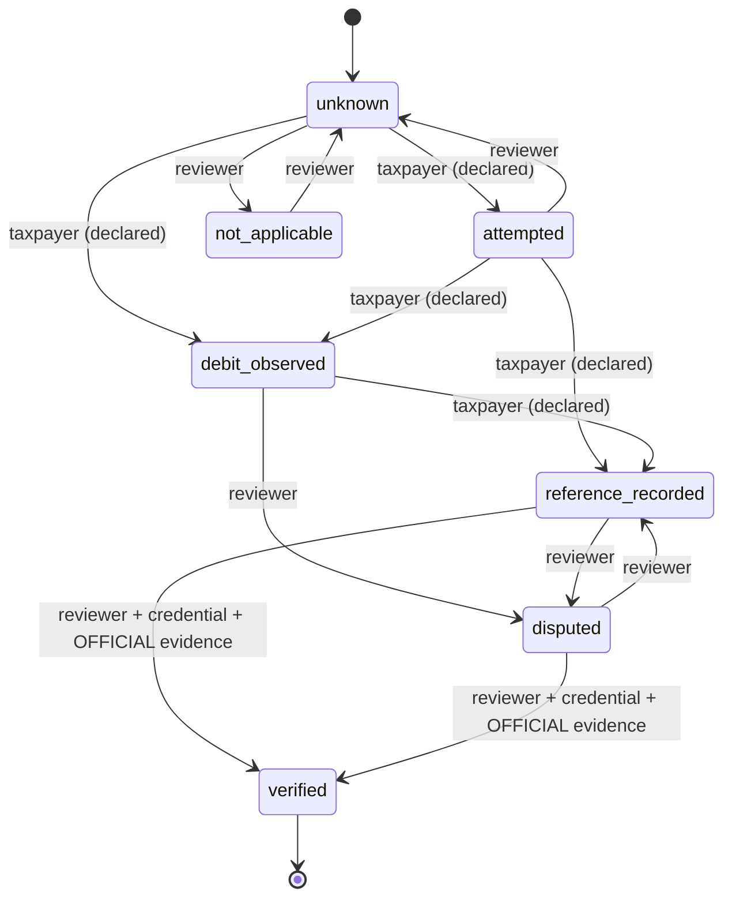
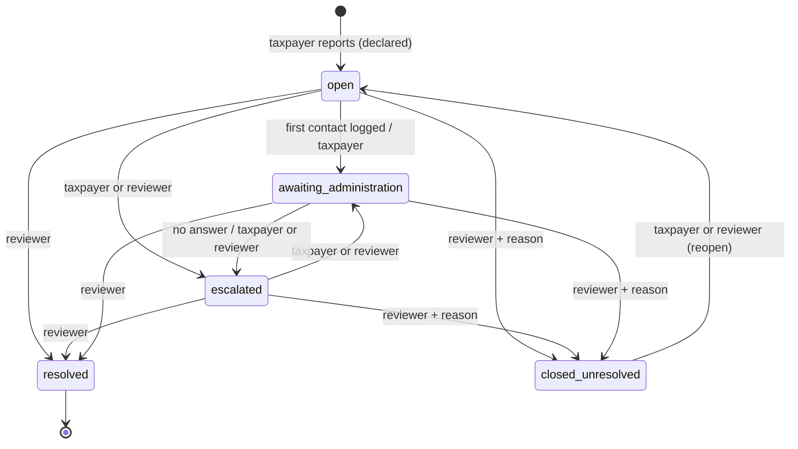

# State machine — incident and tax payment (Agent B)

*The executable version is `lib/incidents.ts`; `scripts/journey-check.mjs` proves the
rules below. If this page and the code disagree, the code is tested and this page is
wrong — fix it.*

## 1. Tax-payment state (`PaymentState`)

Union from backlog P1-1 and the strategy contract:
`not_applicable`, `unknown`, `attempted`, `debit_observed`, `reference_recorded`,
`verified`, `disputed`.

| From | To | Who | Requires |
|---|---|---|---|
| `unknown` | `attempted`, `debit_observed` | taxpayer or reviewer | — (taxpayer's act is `declared`) |
| `unknown` | `not_applicable` | reviewer | credential |
| `attempted` | `debit_observed`, `reference_recorded` | taxpayer or reviewer | — |
| `attempted` | `unknown` | reviewer | credential |
| `debit_observed` | `reference_recorded` | taxpayer or reviewer | a reference ≥ 4 characters (masked at once) |
| `debit_observed` | `disputed` | reviewer | credential |
| `debit_observed` | **`verified`** | **nobody** | **no edge — a debit alone never reaches verified** |
| `reference_recorded`, `disputed` | `verified` | reviewer | credential **and** ≥ 1 cited evidence of kind `official_receipt` or `administration_response` |
| `reference_recorded` | `disputed` | reviewer | credential |
| `disputed` | `reference_recorded` | reviewer | credential |
| `verified` | — | — | terminal |

Evidence kinds: `debit_sms`, `wallet_screenshot`, `bank_statement`, `portal_screenshot`,
`other` are the taxpayer's own record and **never** verify. Only `official_receipt` and
`administration_response` are "official". A taxpayer may *attach* an official receipt;
only a reviewer may *cite* it to verify.

**Mapping to today's schema.** `compliance_cases.payment_evidence_status` is the enum
`not_applicable, unknown, requested, received, verified`
(`supabase/migrations/20261022125435_four_status_dimensions.sql:30-36`,
`lib/cases.ts:76-81`). `requested` / `received` cannot express a debit versus a receipt.
Proposed to Agent A: a new enum for this union (see the handoff), with `requested` →
`unknown` and `received` → `reference_recorded` as the migration mapping, decided by A.

## 2. Incident status (`IncidentStatus`)

`open`, `escalated`, `awaiting_administration`, `resolved`, `closed_unresolved`.

| To | Who | Requires |
|---|---|---|
| `escalated`, `awaiting_administration` | taxpayer or reviewer | — |
| `open` (reopen from `closed_unresolved`) | taxpayer or reviewer | — |
| **`resolved`** | **reviewer only** | credential; a resolution reason; ≥ 1 cited **official** evidence; for `debit_not_recognised`, payment already `verified` |
| `closed_unresolved` | reviewer only | credential; a reason |

`resolved` is terminal: every act on a resolved incident is refused (`closed`).

## 3. Basis of every act

| Actor | Act | Basis recorded |
|---|---|---|
| taxpayer | anything | `declared` — shown "You reported" |
| reviewer | `verified`, `resolved` | `verified` — shown "Verified by a reviewer", reviewer named |
| reviewer | anything else | `recorded` |

## 4. Refusals (the UI shows each in FR and EN)

`not_allowed`, `reviewer_required`, `reviewer_not_credentialed`, `evidence_required`,
`official_evidence_required`, `payment_not_verified`, `reason_required`, `closed`.

## 5. Open questions (not decided here)

1. When a `payment_step_error` incident gets a debit, should its type become
   `debit_not_recognised`? The prototype keeps the type; the journeys say "switch to
   Variant 2". Owner or Agent A to decide; it changes the resolve gate.
2. The waiting period before `disputed` is `unknown` (S-3). The prototype leaves the
   move to the reviewer's judgement and never shows a number of days.
3. Where the payment state lives: on the case (journeys §4, "not duplicated") or on the
   incident. The prototype carries it on the incident for isolation; the handoff asks for
   it on the case, with the incident reading it.
