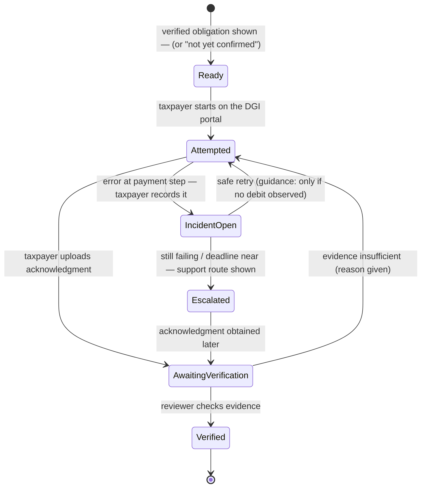
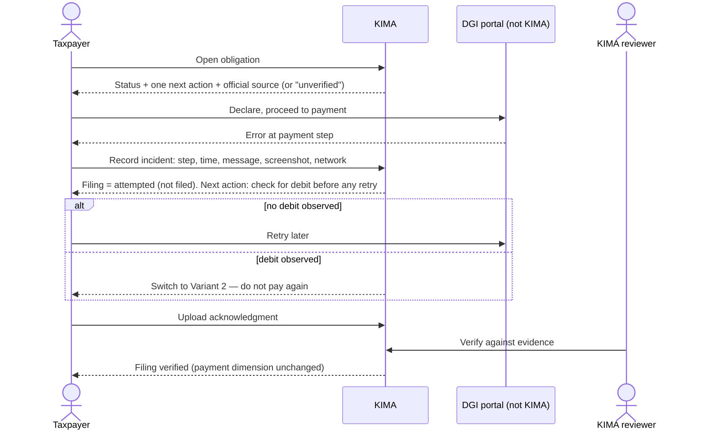
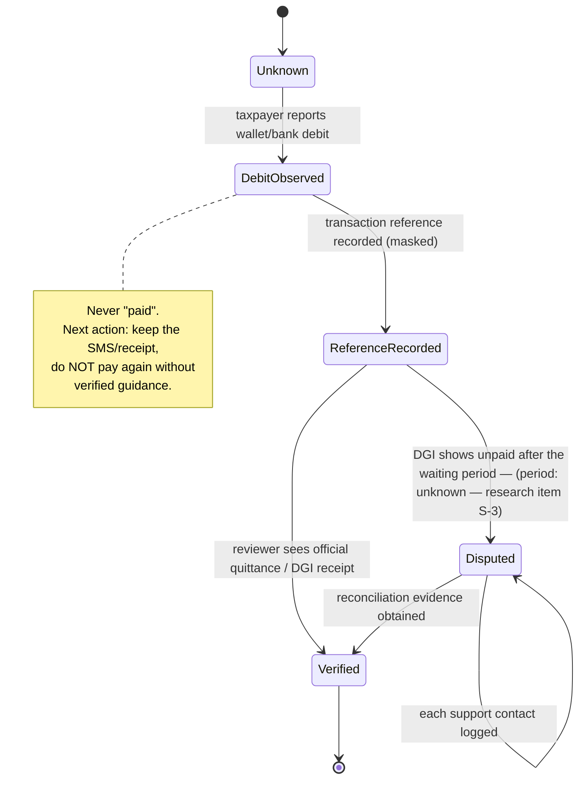
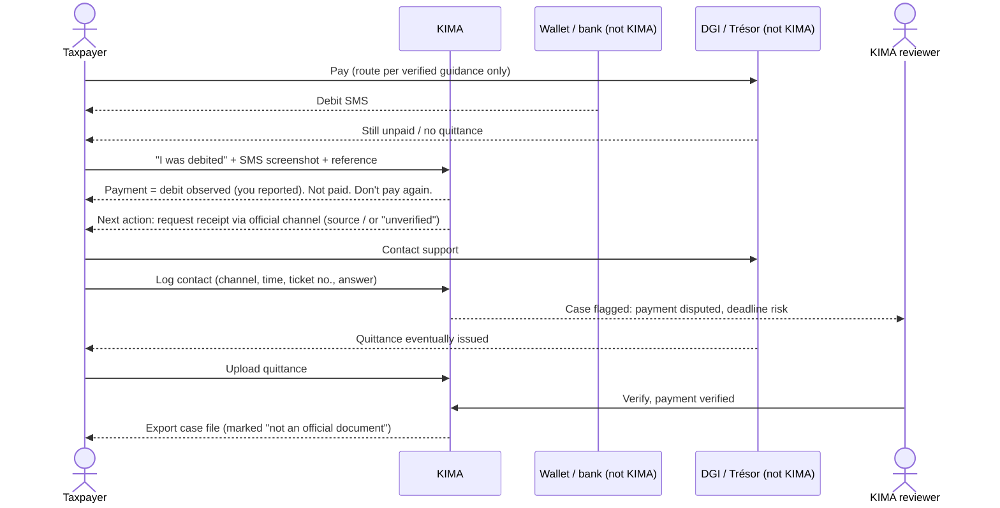
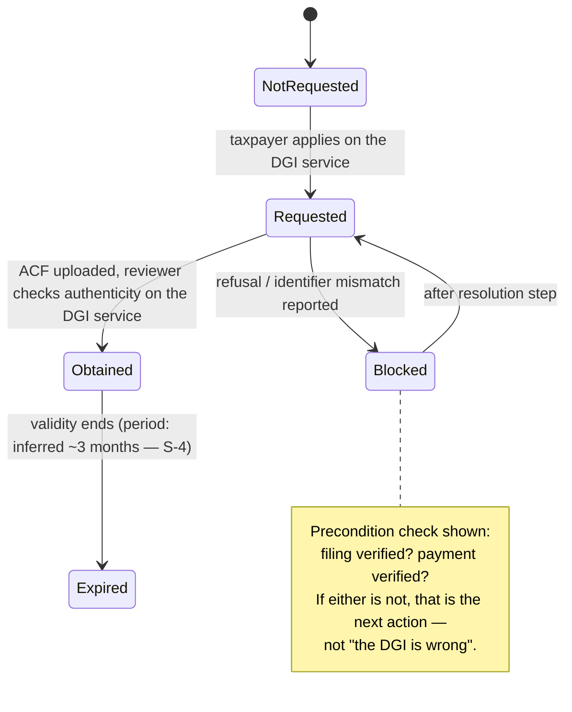
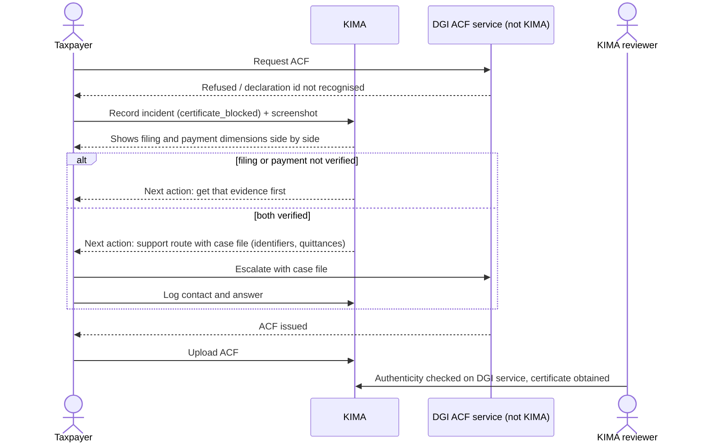

# C — Journeys, state diagrams and swimlanes

Three failure journeys from the brief (§6, §10), for one fictional taxpayer:
**Boutique Ndolo (synthetic)**, a Douala trader declared under the IGS. Nothing below
asserts a rate, deadline, payment route or portal as fact. Where a step depends on DGI
practice, its status is given and the screen would say the same.

## 1. Who controls what

| Step | Controlled by | KIMA's role |
|---|---|---|
| Whether an obligation exists, its amount and date | Law + DGI (art. 16 prorogations by MINFI) | Show it only from a `verified` rule; otherwise "not yet confirmed" |
| Portal availability, sessions, OTP, payment processing | DGI / Trésor / mobile-money operator | None. Record what happened |
| Filing acknowledgment, quittance, payment reconciliation | DGI / Trésor | None. Hold the evidence; a reviewer records it as verified |
| ACF issuance (`fanr.harmony2.cm`, `inferred`) | DGI | None. Never issue, imitate or predict |
| The taxpayer's record, the next step, the case file, escalation guidance | **KIMA** | Full |
| Moving any dimension to `verified` | **A KIMA reviewer** (blueprint §20 rule 11) | Full, on evidence only |

## 2. What evidence moves which status

Five dimensions, never collapsed into one badge. **Taxpayer entries are declarations;
only a reviewer with the cited evidence produces `verified`.**

| Dimension | States (proposed) | Moves to `verified` only on | Who |
|---|---|---|---|
| KIMA work stage | existing `CaseStage` | (not evidence-based — workflow) | Firm |
| Filing acknowledgment | `not_submitted → attempted → awaiting_verification → verified` / `correction_required` (existing) | DGI acknowledgment of submission (document or reference + capture date + source) | Reviewer |
| Tax payment | `not_applicable`, `unknown`, `debit_observed`*, `reference_recorded`*, `verified`, `disputed` | Official quittance / DGI receipt — **never** a wallet SMS or bank debit alone | Reviewer |
| Firm fee | existing `BillingStatus`; pending ≠ paid | Confirmed payment with evidence (existing CHECK) | Firm |
| Certificate (ACF) | `not_requested`, `requested`*, `blocked`*, `obtained`, `expired` | The ACF document itself, authenticity checked by a person on the DGI's own service | Reviewer |

\* declared state: may be set by the taxpayer, shown as "you reported".

## 3. Variant 1 — payment-stage portal error before the deadline

### State

Filing stays `attempted` throughout the incident. A deadline-risk warning appears when the
incident is open within N days of a *verified* due date; it never says the deadline will
be extended.

### Swimlane

## 4. Variant 2 — funds debited, payment not recognised *(first build slice)*

### State (tax-payment dimension)

### Incident record (checked against the existing schema)

| Brief field | Exists? | Proposal |
|---|---|---|
| case_id, taxpayer_id, obligation/period | yes — `compliance_cases` | FK, composite with taxpayer as `document_requests` does |
| incident_type | no | enum: `portal_unavailable`, `payment_step_error`, `debit_not_recognised`, `certificate_blocked`, `other` |
| detected_at with tz | pattern in `lib/dates.ts` | `timestamptz`, entered in Africa/Douala |
| portal, attempted_step | portal keys in `lib/rules.ts:897-940` | `portal_key` + free-text step |
| user-reported error | no | text, declared |
| evidence references | `documents` | join table to `documents` (hashed) |
| transaction ref (masked) | no | stored masked (last 4) + sha256 of the full value for later matching |
| submission ack / payment status | case dimensions | **not duplicated** — read from the case |
| support ticket, contacts | no | `incident_contacts` rows: channel, when, reference, response |
| owner, escalation status, next action | `compliance_cases.owner` pattern | `status` state machine; next action is derived, not stored |
| provenance, last_verified_at | event log | events in a new `incident` dimension; `verified_by`/`verified_at` only on reviewer acts |
| resolution outcome | no | `resolution` enum + reason, required to close |

### Swimlane

## 5. Variant 3 — filed and paid, ACF blocked

### State (certificate dimension)

KIMA never renders a certificate, a seal, a QR code or the word "conforme". The case
file says, verbatim, "This is not an Attestation de Conformité Fiscale."

### Swimlane

## 6. The firm's side

The same rows, read by `case-detail.tsx`: an open incident is a blocker (via
`deriveBlocker`), a `disputed` payment raises `risk()`, and only the reviewer's actions
move a dimension to `verified`. The taxpayer never needs to wait for the firm to *record*
anything — only to have it *confirmed*.
