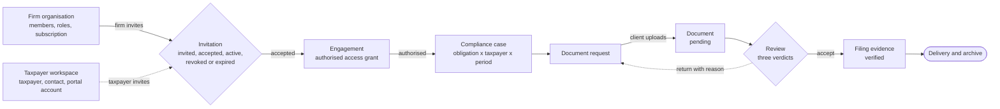

# KIMA OS: QA findings and adoption plan (engineering handoff)

**Date:** 29 October 2026
**Repository:** https://github.com/Chedarl/KIMA-CONSULTING (branch `main`)
**Live site:** https://kima-consulting.vercel.app/fr
**Database:** Supabase project `vhrnrbnjhmxrygvyfirf` (Paris region): https://supabase.com/dashboard/project/vhrnrbnjhmxrygvyfirf

**Status:** Not client-ready. Safety and honesty: 7/10. End-to-end loops: 5/10. No real taxpayer data may be loaded until phases 1, 2 and 7 below are complete.

---

## Contents

1. [Executive summary](#1-executive-summary)
2. [Owner decisions and open questions](#2-owner-decisions-and-open-questions)
3. [Non-negotiable product rules](#3-non-negotiable-product-rules)
4. [Target design](#4-target-design)
5. [Phased plan](#5-phased-plan)
6. [QA test scenarios](#6-qa-test-scenarios)
7. [Issue and gap register](#7-issue-and-gap-register)
8. [Safety rules](#8-safety-rules)
9. [Source documents](#9-source-documents)

---

## 1. Executive summary

**What KIMA OS is.** Practice-management software for accounting firms in Cameroon, modelled on how TaxDome organises a firm's work. Firms and their taxpayer clients work on **one shared set of records**: clients, engagements, compliance cases, document requests, documents, filings, fees and payment incidents. The site is bilingual (French and English) and must work on mobile phones and slow connections. Firms pay a subscription. Taxpayers use a free workspace and can move between firms without losing their account.

**Current state (audit of `main`, the database and the live site, 29 Oct 2026):**

- Done: the P0 security migration `20261027120000` (storage scoping, blocking clients from forging events, delivery only after a verified filing, OTP reset); fee-payment guards (`20261027210000`, `20261027210100`, 24 pgTAP checks); official KIMA OS branding; firm billing, evidence vault and engagements list (PR #6).
- Not done: the shared loop has **never carried a real file**: 0 rows in `documents`, 0 in `storage.objects`, 0 in `messages`. Service requests and onboarding don't create the records the rest of the product reads. Demo flags are still on. 7 of the 10 planned firm screens are missing. Firms can't create cases, tasks, contacts or invoices from the UI. The only tests cover the engine; there are no route or end-to-end tests.
- Seed data: 1 taxpayer, 4 compliance cases, 5 document requests.

**Launch blockers:**

1. Eight `SECURITY DEFINER` functions in `public` can be called through the API by the `anon` and `authenticated` roles (Supabase security advisor, 29 Oct).
2. `member_has()` checks permissions firm-wide instead of per organisation, so tenants aren't isolated.
3. `app_flags.allow_demo_anon` and `app_flags.demo_otp_reveal` are both `true`.
4. There is no firm self-sign-up. It is required because independent firms launch on day one.
5. There are no invitations in either direction, and no revocation or access audit.
6. The document upload and review loop has never been tested end to end.
7. Only 1 of 14 compliance rules has a verified official source.

---

## 2. Owner decisions and open questions

### Final decisions

| Topic | Decision |
|---|---|
| Who can use it at launch | Independent accounting firms from day one, not only KIMA Consulting. Firm self-sign-up, per-firm isolation and a two-firm isolation test block launch. |
| Incident recovery | Built after firm workflows. |
| Invitations | Both directions in the first release: firm → taxpayer and taxpayer → firm, with revocation and an access audit. |
| Brand palette | Adopt the Firm Workspace brief palette (section 4.5). It replaces navy `#163B66` and teal `#1E9E74`. |
| Logo | Keep the official artwork exactly as it is. Emerald green and gold appear only inside the logo, never as UI or button colours. |
| Success colour | New token `success` = `#15803D`. It is separate from the logo's emerald. |

### Still open

| Question | Notes |
|---|---|
| Should the multi-tenant architecture document become the controlling requirement in `CLAUDE.md` and the product blueprint? | Unanswered. Don't edit `CLAUDE.md` or the blueprint on this point until the owner decides. |
| How long are records kept after a firm's access is revoked? | To be settled during the pilot. |
| What do firms pay? | To be tested with pilot offers. There is no subscription model in the schema yet. |

---

## 3. Non-negotiable product rules

1. **Shared records.** The firm workspace and the taxpayer portal read and write the same rows. No screen keeps its own copy. `case_events` is the single history every screen reads.
2. **Request → portal → review queue.** A firm request shows up in the client portal. The client's upload creates a storage object, a `documents` row with status pending, and a `request_submitted` event. The upload then appears in the firm's review queue.
3. **Received is not accepted.** Receiving a file never means it is approved. Uploaded, received, accepted and verified are separate states.
4. **Four status dimensions kept apart:** document acceptance, case stage, filing status, and payment (firm fees separate from government tax payments). None of them can be inferred from another.
5. **Three verdicts.** Reviewing a document records three separate verdicts, and the result is either accept or return with a reason. A return sends the request back to the client and increments `returned_count`.
6. **Filing and tax-payment honesty.** "Filing attempted" is never shown as "filed". A debit seen on a bank statement is never shown as "tax paid". Only an officially verified receipt counts as paid. Filing is verified only with an evidence reference (enforced by `filing_verified_requires_evidence`).
7. **Tenant isolation.** A firm never sees another firm's clients, documents, invoices or tasks. A taxpayer never sees another taxpayer's records. A KIMA admin gets no automatic access to client data. This is enforced in the database (RLS), in storage policies and on the server, not only in the UI.
8. **No invented tax rules.** Every obligation or deadline either has a verified source and effective date, or is clearly labelled "unverified". Never claim a DGI (tax authority) integration or automatic filing or payment confirmation.
9. **Seven-step feature gate.** A feature is done only when all seven are true:
   1. the schema or migration is reviewed;
   2. the server action writes and then reads back its row;
   3. the firm side shows it;
   4. the client side shows it;
   5. the history (`case_events`) records it;
   6. tests cover it;
   7. it has been checked in French and English at widths 375, 768, 1024 and 1440 px.
10. **Finish each phase before the next.** Each phase is complete and verified against its exit criteria before work from the next phase is merged. The brand track (B) is the only exception and runs in parallel.

---

## 4. Target design

### 4.1 Record model

The backbone is: firm organisation → engagement (the authorised access grant) → taxpayer → compliance case → document request → document. A firm and a taxpayer are linked through an engagement, and the relationship is many-to-many: one firm has many taxpayers, and one taxpayer can work with several firms over time.

Suggested entities from the Firm Workspace brief, mapped to the existing schema. Extend the existing tables; don't duplicate them.

| Concept | Existing table or function | Gap |
|---|---|---|
| Firm (tenant) | organisations, `member_has()`, `current_firm_role()` | Permissions are firm-wide, not per organisation |
| Firm memberships and roles | firm member tables, `member_has(cap)` | Need taxpayer owner, firm owner, accountant (assigned cases only) and reviewer roles; KIMA admin with no client data |
| Access grant | `engagements` (draft / authorised / revoked, `revoked_at`) | No invited, accepted or expired states; must confirm `can_see_taxpayer()` honours revocation |
| Invitations | `workspace_invites` (0 rows) | No flow in either direction |
| Onboarding | `registrations` | Approval doesn't create a taxpayer, contact or portal account |
| Cases and history | `compliance_cases`, `case_events`, `lib/cases.ts` `advance()` | No client-approval or cancelled stage |
| Documents | `document_requests`, `documents`, `storage.objects` | Never used end to end; no signed URLs, file-type checks or versions |
| Filing | `filing_*`, `filing_verified_requires_evidence` | Add the attempted and submitted-unverified states |
| Payment incidents | `lib/incidents.ts` (engine only) | No tables: backlog P1-2 is approved but not built |
| Firm fees | `service_payments` | Done: confirmed once by the firm |
| Audit | `case_events` | Need an access-grant and revocation audit; events must be immutable |

**State machines (from the Firm Workspace brief):**

- **Job pipeline:** Documents requested → Documents received → Preparation → Internal review → Client approval → Submission attempted → Submission verified → Completed. Branches: Blocked, Returned for correction, Cancelled.
- **Filing state:** `not_started | preparing | attempted | submitted_unverified | verified | blocked`
- **Tax payment state:** `not_started | initiated | debit_observed | disputed | officially_verified`. A debit is never proof of payment. Firm service invoices are tracked separately from tax payments.

### 4.2 End-to-end loops

1. **Invitation → engagement.** Either side invites. Acceptance makes the engagement active and gives the firm access scoped to that taxpayer. Revocation ends access immediately and writes an audit event. The taxpayer keeps the account when changing firms.
2. **Onboarding → approved taxpayer.** The apply form writes `registrations`. Firm approval creates the taxpayer, the contact link, a draft engagement and the portal account in one transaction, inside the approving member's organisation.
3. **Request → upload → review.** The firm raises a request on a case. The client uploads a file, which creates the storage object, a pending `documents` row and a `request_submitted` event. The firm records the three verdicts, then accepts or returns.
4. **Case → evidence → delivery.** Stages move only through `advance()`. A filing is verified only with an evidence reference. Delivery requires a verified filing. The archive lists only verified work.
5. **Service request → engagement.** A client's service request writes a draft `engagements` row in the client's own organisation, plus an event. Today it writes only a `messages` row, and it attaches to the oldest organisation (`components/client-portal/services-board.tsx` L152–188, L165). The firm authorises the draft, and cases are proposed from verified obligations.

### 4.3 Screen inventory

| Screen | Purpose | Primary action | Records read / written | Empty or error state |
|---|---|---|---|---|
| Public home | Explain the product and route visitors to apply | Create my workspace | none | Contact fallback if applying fails |
| Apply (onboarding) | Collect the applicant's declared details | Submit application | writes `registrations` | Draft saved; clear refusal text |
| Firm self-sign-up (new) | Create a firm tenant | Create firm | writes organisation, owner membership | Shown only after phase 1 |
| Team settings (new) | Invite, revoke and assign staff roles | Invite member | memberships; audit | Permission-denied for non-owners |
| Firm dashboard | KPIs, deadline calendar, action centre, task queue | Open the filtered list | cases, requests, incidents, invoices | Shows data freshness and source |
| Firm triage | Review and approve applications | Approve and open workspace | reads `registrations`; writes `taxpayers`, `contacts`, `engagements`, `portal_accounts` | "No pending applications" |
| Client 360 | Everything about one taxpayer: overview, compliance, documents, tasks, messages, billing, activity | Raise request | everything for that taxpayer | Unverified profile flagged |
| Compliance board | Obligations, filing evidence, blockers | Log a filing attempt | filing records | Rules without a source labelled unverified |
| Workflow board | Pipeline stages, assignments | Move a card (allowed transitions only) | `compliance_cases`, `case_events` | Shows why a move is blocked |
| Document centre | Inbox and the three verdicts | Accept or return | `documents.acceptance`, `document_requests`, `case_events` | "Nothing to review" |
| Case | Move a case forward on evidence | Advance stage | `compliance_cases`, `case_events` | Refusal reason shown |
| Review and filing | Second review, filing evidence | Record filing evidence | `filing_*`, `case_events` | Missing evidence blocks the action |
| Delivery and archive | Deliver verified work | Deliver to client | verified filings | Not deliverable until verified |
| Payment incident detail | Debit evidence, dispute timeline, one recommended next step | Log debit or attach evidence | incident tables (to build) | A debit is never shown as paid |
| Client dashboard | One next action | Send this document | cases, requests; uploads | "All caught up" |
| Client requests | What the firm needs | Upload file | `storage.objects`, pending `documents` | Return reason shown |
| Client services | Ask for a new service | Request service | draft `engagements` + event | Waiting for the firm to authorise |
| Client payments | Fees and receipts | Report a payment | pending `service_payments` | Waiting for confirmation |

**Navigation (firm side):** Dashboard, Clients, Compliance, Workflows, Documents, Messages, Tasks, Billing, Reports, Settings. Several items are currently `ready: false` in `app/[locale]/workspace/layout.tsx`.

**Layout:** 240 px collapsible left sidebar and a 64 px header with workspace switcher, search, notifications and account menu. 12-column grid, 24 px gutters, maximum width about 1440 px. Tablet uses a condensed sidebar. Mobile uses a drawer, single-column cards, a sticky primary action, and a card alternative for tables.

### 4.4 Interaction standards

- **Feedback on actions.** Every write reads its row back (`lib/db-write.ts`). The success message names the record. A refusal shows the engine's reason.
- **Filters.** Queues filter by status, taxpayer and due date, and the filter state is kept in the URL.
- **States.** Every screen has loading, empty, error and permission-denied states. An empty state says what is missing and gives the one next action.
- **Accessibility.** 3 px focus ring, 44×44 px touch targets, full keyboard navigation, and a hover state on every clickable row.
- **Honest status words.** Received, accepted, filed, verified and paid are always separate words.
- **Mock data.** Any mock-only interaction is labelled as such.
- **Languages.** French and English at parity, through typed dictionaries, with no clipped text.

### 4.5 Brand tokens

| Token | Hex | Use |
|---|---|---|
| `navy` | `#18243B` | App chrome, headings |
| `indigo` | `#455DA8` | Primary actions, links |
| `background` | `#F7F9FC` | Page background |
| `border` | `#DCE3EC` | Borders, dividers |
| `body` | `#273248` | Body text |
| `warning` | `#B56A15` | Warnings |
| `error` | `#B63B45` | Errors |
| `success` | `#15803D` | Success (new token, not the logo emerald) |
| `success-tint` | `#E8F5EC` | Light success badge background |

Font: Inter or the system sans-serif, base size 14–16 px.

**Contrast of `success #15803D`** (WCAG AA requires 4.5:1 for text):

| Combination | Ratio | Result |
|---|---|---|
| `#15803D` text on `#FFFFFF` | 5.02:1 | Pass |
| `#15803D` text on `#F7F9FC` | 4.76:1 | Pass |
| White text on a `#15803D` badge | 5.02:1 | Pass |
| `#273248` text on a `#E8F5EC` badge | 11.43:1 | Pass |
| `#15803D` text on a `#E8F5EC` badge | 4.47:1 | **Fail: don't use** |

**Logo rules:** the official lockups in `public/brand/` (navy, emerald check, gold fold) stay unchanged. Emerald and gold are used only inside the logo, never in buttons or other UI. Status is never shown by colour alone; always pair it with a word and an icon.

---

## 5. Phased plan

Order: 0 → 1 → 2 → 3 → 4 → 5 → 6 → 7. Track B runs in parallel once phase 1 is done. Map every task to its ID in `docs/strategy/2026-10-27-taxpayer-first/backlog.md` and update that file's statuses. Don't keep a separate competing roadmap.

### Phase 0: Truth reset

- [x] Correct the README section "Where the work stands": the P0 fixes are merged and applied (`20261027120000`), not a draft PR.
- [x] Update `docs/foundation/frontend-backend-coverage.md` (inventory dated 22 Oct): the storage, incidents and fee-report rows.
- [x] Map every phase task below to `backlog.md` IDs and update their statuses.
- [x] Draft the proposed `CLAUDE.md` and blueprint wording for the multi-tenant model, and **hold it** until the owner decides.
- [x] Seed a synthetic dataset with 2 firms, 2 taxpayers, files and messages. Synthetic data only.
- [x] Fix the home page "How it works" step 01, which offers a firm workspace while firm sign-up is hidden.

**Exit:** the docs match `main` and the database, and the seed has been reviewed.
**Depends on:** nothing.
**Out of scope:** any feature work.

**Phase 0 done 29 Oct 2026** (branch `agent-a/phase-0-truth-reset`). Backlog IDs
PH0-1…PH0-6.

**Seed reviewed 30 Oct 2026**, which was the one exit criterion still open, and it
found three defects, now fixed:

- Storage paths were shaped `taxpayers/<id>/...`. `storage_path_taxpayer(name)` reads
  the *first* segment and returns null for anything that is not a bare UUID, so
  `can_see_taxpayer(null)` is null and the file would have been unreadable by the client
  who uploaded it and by their own firm. The path now starts with the taxpayer id.
- No member or contact was bound to an `auth.users` row. `member_has()` and
  `can_see_taxpayer()` answer for `auth.uid()`, so the two firms existed and nobody
  could act as them, which is most of what the seed is for. All six now have sign-ins.
- The document rows had no files behind them. Object bytes live in the storage service,
  not in Postgres, so a SQL seed cannot put them there; `npm run seed:storage`
  (`scripts/seed-storage.mjs`) uploads a generated one-page PDF per seeded document and
  writes the real `byte_size` and `sha256` back onto the row.

The database half of the exit was re-checked against the live project on 30 Oct through
the Supabase MCP server, which was unreachable on 29 Oct: 1 organisation, 3 firm members
all with `organization_id` null, 1 registration with no organisation, 1 authorized
engagement. The figures in this document hold.

### Phase 1: Security and per-firm isolation (blocks launch)

- [x] Revoke `EXECUTE` from `anon` and `authenticated` on these functions, or move them out of the `public` schema: `auth_identity_is_single`, `can_see_taxpayer`, `client_taxpayer_ids`, `current_firm_role`, `current_member_label`, `demo_taxpayer_id`, `member_has`, `portal_request_code`. Keep only the calls RLS needs, and record in writing why each remaining one is justified. — **Moved, not revoked** (#27, `20261030020000`). Revoking is not available: Postgres checks `EXECUTE` in a policy expression against the querying role, so it breaks the policy instead of closing the endpoint; proven in CI. Eleven helpers now live in a `private` schema PostgREST does not publish. One justified exposure, `can_write_client_note`, with T-53 asserting it is the only one.
- [x] Scope `member_has()` and `can_see_taxpayer()` to the member's organisation (backlog P2-5 / R-47). — #22, `20261029213000`. Access runs through an accepted, unrevoked engagement; ~40 policies rewritten; the production backfill gave all 3 `firm_members` rows an organisation.
- [x] Make sure revoked engagements (`revoked_at`) remove access in every policy and helper. — T-49 sets `revoked_at` alone, leaving `status` untouched, and the next read is refused.
- [x] Add policies to `app_flags`, or document why it has none (advisor note: RLS on, no policy). — Documented in a `comment on table` and the grants revoked as well. Nothing reads it through the API; `private.flag_enabled()` reads it as its owner. Lint 0008 on this table is expected from here on.
- [x] Set `app_flags.allow_demo_anon` and `app_flags.demo_otp_reveal` to false in any environment that will hold real data (R-32/R-36). — Both `false` on production 30 Oct 02:13 UTC, verified after the change.
- [x] Set `SUPABASE_SERVICE_ROLE_KEY` in the Vercel environment through the dashboard, never in the repo. Then remove the fallback to the `auth-codes` Edge Function where it's no longer needed. — The key has been set for every environment since 23 Oct. **Removing the fallback is still open** and is the one half of this item not done.
- [ ] Enable leaked-password protection in Supabase Auth. — **Blocked:** Pro-plan feature, refused on the current plan. Justified in writing as R-50: no account in this product has a password, so neither a leaked one nor a short one is reachable today. Both become live the moment any password flow is enabled.
- [x] Write a pgTAP and route test suite for two firms: Firm A can't read Firm B's clients, documents, invoices, tasks or storage objects. — 37 pgTAP checks in `supabase/tests/two_firm_isolation_test.sql` and 17 more in `supabase/tests/engagement_grant_test.sql`, both directions, reads and writes. **The route half is not written**; the suite is SQL only.

**Exit:** the security advisor is clear, or each remaining item is justified in writing; the two-firm test is green; an anonymous visitor sees no taxpayer data.
**Depends on:** phase 0.
**Out of scope:** new screens.

**Phase 1 exit met 30 Oct 2026, with two new findings that are not in the list above.**
All three exit conditions hold: the security advisor is down from 17 findings to 3, and
each of the 3 is justified in writing (`can_write_client_note` — the one deliberate
exposure, T-53; `app_flags` RLS with no policy — the table comment; leaked-password
protection — R-50). The two-firm suite is green at 37 checks, with 17 more on the
engagement grant itself. An anonymous visitor reads no taxpayer: `allow_demo_anon` is
false and T-57 pins the behaviour.

Two items not on the list surfaced while doing it. **The first is now closed and the
second is not** (30 Oct, after the owner's "proceed"):

- **A firm can grant itself access.** ~~The `engagements` INSERT policy asks only for
  `engagement.create` in the row's own organisation, and `status` defaults to
  `'authorized'`, so any firm can insert an authorised engagement against any taxpayer
  and read that taxpayer immediately.~~ **Fixed 30 Oct by `20261030070000`** (risk R-51),
  on the owner's "proceed" of the fix plan. The finding was verified first rather than
  taken on trust, and reproduced: on a replayed database without the migration the
  self-grant INSERT raised nothing and Firm A then read Firm B's taxpayer (`have: 1,
  want: 0`). The interim rule this section proposed is what was built, plus the three
  things it did not mention and the hole needed: an engagement **opens** as a draft (the
  `status` default is now `'draft'` and `authorized_at` has no default, so the two-step
  draft-then-authorise route is closed too), only the taxpayer writes `accepted_at`, and
  a firm may authorise alone only for a taxpayer **no other firm currently holds** —
  which is what keeps the onboarding path working, since a firm that has just created a
  taxpayer is the only firm engaged with them. 17 pgTAP checks in
  `supabase/tests/engagement_grant_test.sql`, ten of which fail without the migration.
  **Residual:** a firm can still authorise an engagement against a taxpayer no firm
  holds, without consent. It cannot find such a taxpayer through the API — it would have
  to guess a UUID — but the phase 3 invitation flow is what actually closes it. Carried
  as R-51.
- **A public application is not routed to a chosen firm.** An unassigned application is
  readable by any firm member who works client files, and the first firm with
  `engagement.create` to act on it claims it. That was the deliberate fix for the review
  queue going permanently empty, but it is not the same as an applicant choosing a firm.
  Phase 2 owns onboarding and should decide the routing rule.

Two further open items carried from the list: the `auth-codes` fallback removal, and the
route-level half of the two-firm suite.

**A live break found with F-01 and fixed with it.** `engagements_status_known`, the CHECK
added by `20261029213000`, names six states and `'pending'` is not among them —
but `draftEngagement()` in `lib/engagements.ts` wrote exactly that. Every engagement
insert through the onboarding wizard and the engagements screen had therefore been
refused since that migration merged on 30 Oct 02:42 UTC. `20261030070000` and its commit
set it to `'draft'`, and `scripts/engine-check.mjs` asserted the wrong value too, so
nothing caught it. A value-matching rule over free text is exactly what that migration's
own header warned about.

### Phase 2: Firm self-sign-up and onboarding (blocks launch)

- [ ] Firm sign-up flow: create the organisation and the owner membership. Unhide it through `OPEN_WORKSPACE_KINDS` **only after phase 1 is done**.
- [ ] Team settings: invite staff, revoke staff, assign roles (owner, accountant, reviewer), with an audit event for every sensitive change.
- [ ] Onboarding approval in one transaction: `registrations` → `taxpayers` + `contacts` + draft `engagements` + `portal_accounts`, inside the approver's organisation.
- [ ] Make the home page and live site consistent with what's actually open.

**Exit:** a new firm signs up, invites staff, and sees nothing from any other firm; the two-firm test passes with self-signed-up firms.
**Depends on:** phase 1.
**Out of scope:** billing (pricing is still open).

### Phase 3: Invitations in both directions

- [ ] Firm invites taxpayer, and taxpayer invites firm, both using `workspace_invites`.
- [ ] Lifecycle: Invited → Accepted → Active → Revoked / Expired, with expiry enforced on the server.
- [ ] Access audit: who granted access, what was accessed, and when access ended.
- [ ] Revocation takes effect immediately; signed URLs have a short time-to-live.
- [ ] Change the client service request (`services-board.tsx` L152–188) to create a draft engagement in the client's own organisation instead of a message, and stop using the oldest organisation (L165).

**Exit:** the demo with two firms and two taxpayers passes: Firm A invites Taxpayer 1, Taxpayer 2 invites Firm B, each pair sees only its own records, and revocation works.
**Depends on:** phase 2.
**Out of scope:** billing and pricing.

### Phase 4: Firm workflows

- [ ] Create a case, assign a task, and request documents from the UI, with no hand edits to the database.
- [ ] Screens: Firm dashboard, Client 360, Workflow board, Compliance board, Team settings.
- [ ] Add the client-approval and cancelled stages to `lib/cases.ts` and the matching transitions in `advance()`.
- [ ] Role-based views with permission-denied states; an accountant sees only assigned cases.
- [ ] Redesign the work queue (paused since 23 Oct).

**Exit:** the full workflow runs in the UI and every action passes the seven-step gate.
**Depends on:** phase 3.
**Out of scope:** automation, reports.

### Phase 5: Secure document exchange

- [ ] Client upload creates the private storage object, a pending `documents` row and a `request_submitted` event.
- [ ] Short-lived signed URLs, issued only after an authorisation check; non-guessable object keys.
- [ ] File-type validation by content, not by extension, plus a size limit.
- [ ] Document versions; return with a reason; `returned_count` incremented.
- [ ] Uploaded, received, accepted and verified kept as separate states.
- [ ] Clear signed-out states on portal pages, which today show only a heading.

**Exit:** the request → upload → return → re-upload → accept loop works in French and English at 375, 768, 1024 and 1440 px; reading another tenant's object is refused.
**Depends on:** phase 4.
**Out of scope:** OCR, automatic acceptance.

### Phase 6: Incident recovery

- [ ] Payment-incident schema (backlog P1-2) with the reviewer credential (P1-8).
- [ ] Incident detail screen: debit evidence, dispute timeline, one recommended next step.
- [ ] Idempotency keys on the server for every incident, filing and payment write.
- [ ] Only a reviewer can set `officially_verified`, and only on the server.
- [ ] Bulletins (P1-9).

**Exit:** a debit is never shown as paid; retries never create duplicates.
**Depends on:** phase 5.
**Out of scope:** day counts.

### Phase 7: Launch validation (blocks launch)

- [ ] Firm self-sign-up, per-firm isolation and the two-firm test all green on the release candidate.
- [ ] End-to-end test suite for the whole priority journey.
- [ ] Independent security review; zero unresolved critical or high findings.
- [ ] Low-bandwidth and mobile testing.
- [ ] Privacy and legal review.
- [ ] Comprehension test with 5–10 taxpayers.
- [ ] Pilot with 5 firms in Douala and Yaoundé (10–50 clients each), measuring document-collection time, follow-up time, overdue tasks, completion visibility and willingness to pay. Settle retention and pricing here.
- [ ] A verified source and effective date for every active obligation (today 1 of 14 rules is verified).

**Exit:** all launch gates are met, and the owner separately approves the release.
**Depends on:** phases 1–6.
**Out of scope:** e-signature, Mobile Money billing, advanced reporting, TaxDome-style automation.

### Track B: Brand migration (parallel, after phase 1; never blocks security work)

- [ ] Replace the design tokens with the palette in section 4.5.
- [ ] Update components, including status badges with a word and an icon.
- [ ] Update transactional email templates.
- [ ] Update README §9 and blueprint §9.
- [ ] Leave the logo artwork in `public/brand/` unchanged.

**Exit:** no `#163B66` or `#1E9E74` left in the code; AA contrast everywhere; French and English screenshots at 4 widths.
**Out of scope:** redrawing the logo.

---

## 6. QA test scenarios

| Phase | Scenario | Pass condition |
|---|---|---|
| 1 | Anonymous call to `/rest/v1/rpc/member_has` and `/rest/v1/rpc/demo_taxpayer_id` | Refused |
| 1 | A Firm A member lists Firm B's clients, documents and tasks | Zero rows, enforced by RLS and storage |
| 1 | Anonymous visitor with demo flags off | Sees no taxpayer data |
| 2 | Try to reach firm sign-up before phase 1 is done | Still hidden on the live site |
| 2 | A new firm signs up and invites an accountant | Its own tenant; zero rows from other firms; invite audited |
| 3 | Firm A invites Taxpayer 1; Taxpayer 2 invites Firm B; both accept | Each pair sees only its shared records |
| 3 | Taxpayer revokes Firm B; Firm B reloads and reuses an old signed URL | Refused; URL expired; revocation in the audit log |
| 3 | An invitation isn't accepted before it expires | Status Expired; no access |
| 4 | Firm creates a case and assigns an accountant; a different accountant opens it | Follows the role matrix: assigned cases only |
| 5 | Firm requests a bank statement → client uploads → firm returns it → client re-uploads → firm accepts | Visible on both sides; `returned_count` goes up; never "accepted" before the verdict |
| 5 | Client B tries to read Client A's storage object | Refused by storage policy and RLS |
| 5 | Upload an `.exe` renamed to `.pdf` | Rejected |
| 5 | Try to deliver an unverified filing; record filing evidence without a reference | Refused by the engine and by `filing_verified_requires_evidence` |
| 6 | A taxpayer posts an `officially_verified` payment event | Rejected on the server |
| 6 | Resubmit a debit on a poor connection | Only one record |
| 7 | A rule without a verified source is shown to a taxpayer | Labelled "unverified"; no authoritative deadline |
| B | Search the code for `#163B66` and `#1E9E74`; check contrast | None left; AA contrast; status never shown by colour alone |
| All | Layout and language sweep, including loading, empty, error and permission-denied states | French and English at 375, 768, 1024 and 1440 px; no overflow; focus visible |

---

## 7. Issue and gap register

| # | Issue | Severity | Status | Evidence |
|---|---|---|---|---|
| 1 | Separate firms aren't isolated: `member_has()` is firm-wide | Critical | Open | Backlog P2-5, R-47 |
| 2 | 8 `SECURITY DEFINER` helpers callable by `anon` and `authenticated` | High | Open | Supabase security advisor, 29 Oct |
| 3 | `allow_demo_anon` and `demo_otp_reveal` are `true` | Blocks real data | Open | `app_flags` rows |
| 4 | `SUPABASE_SERVICE_ROLE_KEY` not set on Vercel | High | Open, unverified | README; sign-in falls back to the `auth-codes` Edge Function |
| 5 | No firm self-sign-up; firm sign-up hidden | High (blocks launch) | Open | `OPEN_WORKSPACE_KINDS` (PR #10) |
| 6 | No invitation lifecycle in either direction | High | Open | `workspace_invites` has 0 rows; engagements only have draft, authorised and revoked |
| 7 | Not verified that revocation removes access | High | Unverified | `revokeEngagement` sets `revoked_at`; helper behaviour not checked |
| 8 | A service request writes only a message and attaches to the oldest organisation | High | Open | `components/client-portal/services-board.tsx` L152–188, L165 |
| 9 | Onboarding never becomes a taxpayer with a portal account | High | Open | `registrations` only; a registered taxpayer can't sign in |
| 10 | Firms can't create cases, tasks, contacts or invoices from the UI | High | Open | Audit PR #11 |
| 11 | Document loop never used: 0 documents, 0 storage objects | High | Partly fixed | Migration `20261027120000` applied |
| 12 | No signed URLs, file-type checks or versions | High | Open | Storage policies are scoped by path only |
| 13 | Firm screens missing (triage, Client 360, document centre, review and filing, dashboard, delivery) | High | Open | README "Remaining screens" |
| 14 | No route or end-to-end tests | High | Open | README test section |
| 15 | Only 1 of 14 compliance rules has a verified source | High | Open | README |
| 16 | Thin demo data (1 taxpayer, 4 cases, 0 messages, 0 documents) | High | Open | Row counts, 29 Oct |
| 17 | Incident recovery is only a mock prototype; no tables | Medium | Open (planned) | `/prototype/incident`; `lib/incidents.ts` |
| 18 | No idempotency keys | Medium | Open | Not found in reviewed code |
| 19 | No client-approval or cancelled stage | Medium | Open | `lib/cases.ts` |
| 20 | Navigation items not ready (Tasks, Reports, Settings) | Medium | Open | `app/[locale]/workspace/layout.tsx` |
| 21 | Signed-out portal pages show only a heading | Medium | Open | Live `/en/app/requests` |
| 22 | Work queue redesign paused | Medium | Open | No PR since 23 Oct |
| 23 | README "P0 fixes: draft PR" contradicts `main` | Medium | Open | Migration `20261027120000` is applied |
| 24 | Coverage doc out of date | Medium | Open | `docs/foundation/frontend-backend-coverage.md` |
| 25 | DSF Bridge has no screen | Medium | Open | Coverage doc: MISSING |
| 26 | Brand tokens still the old navy and teal | Medium | Open (decided) | README §9, blueprint §9 |
| 27 | No subscription or pricing model | Medium | Open (pilot) | Schema |
| 28 | Dashboard KPIs incomplete (4 tiles, no data freshness) | Low | Partly done | `firm-dashboard.tsx` |
| 29 | Home step 01 offers a firm workspace while sign-up is hidden | Low | Open | Live `/fr` |
| 30 | Leaked-password protection disabled | Low | Open | Supabase advisor |
| — | P0 security fixes, fee-payment guards, branding, migration `20261023180000` | — | Fixed | PRs #15–#21; `schema_migrations` |

---

## 8. Safety rules

- **No real taxpayer data** until phases 1, 2 and 7 are complete and the owner has approved. Until then use synthetic data only.
- **Demo flags:** `allow_demo_anon` and `demo_otp_reveal` must be `false` in any environment holding real data. Never show OTP codes in the UI outside a demo environment.
- **Secrets:** never put keys, tokens, passwords or connection strings in the repository, pull requests, issues, chat or this document. Set them in the Vercel and Supabase dashboards only. The service-role key stays on the server.
- **Migrations:** reviewed in a pull request before they are applied; nothing destructive without owner approval; never edit production data by hand.
- **Releases:** no merge to `main` and no production deploy without owner approval. Each phase must meet its exit criteria before the next phase's work merges.
- **Tax claims:** no invented obligations or deadlines, and no claim of a DGI integration.

---

## 9. Source documents

- Roadmap review: six stages, launch gates, one priority journey.
- Accounting-firm-first decision: firms pay; 5-firm pilot.
- Multi-tenant architecture: firm ↔ engagement ↔ taxpayer, invitations in both directions.
- Firm Workspace design and engineering brief, 27 Oct 2026: screens, tokens, state machines, security tests.
- Repository files: `README.md`, `CLAUDE.md`, `docs/strategy/2026-10-27-taxpayer-first/backlog.md`, `docs/foundation/frontend-backend-coverage.md`.
